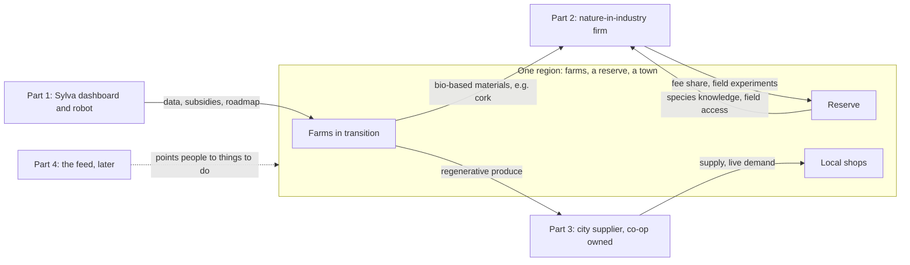

# 0. The plan: from consuming to doing

This is the plan the rest of the report serves. It states the goal in one sentence, names the four parts that reach it, says which are live, and shows how they feed each other. Chapter 1 is the human pattern behind it, chapter 4 is the manifesto for its last part, and chapter 6 is the deep dive on the part that gets most of the effort now.

Tags as in the other chapters: [Certain] read from a repository or primary source; [Likely] consistent across sources, primary not read; [Guessing] an inference to test. Statements of what the plan intends are not tagged.

Written 2026-10-09.

## 0.1 The goal in one sentence

Reroute the consumption loop most people live in today into doing: give farmers, engineers, shopkeepers and, last, everyone else a real thing to do in a real place, and make doing it pay better than not doing it.

Every decision in every part gets the same three-question test:

1. **Does it end with someone doing something real,** off screen, that changes land, a product, a shop or a community?
2. **Does the value stay in the place** (the farm, the reserve, the shop, the town) rather than flowing to a distant middleman?
3. **Can we prove it,** with data a sceptic would accept, rather than asking people to believe it?

If a feature, a client or a partner fails all three, it is not part of the plan.

## 0.2 The four parts

| Part | What it is | Who does more | What it proves | Status | Effort now |
|---|---|---|---|---|---|
| 1. Land | Sylva: farm dashboard paired with a field robot | Farmers | Regenerative farming and agroforestry keep soil healthier and earn more of the subsidies farmers are owed | Live, being built | Ongoing |
| 2. Industry | A nature-in-industry firm: biomimicry plus nature-friendly processes, with a database and reserve partnerships | Engineers and R&D teams | Nature is the first place to look for a better design, material or process, and that looking can fund the places nature lives | Main focus | Most |
| 3. City | Local commerce: the city's supplier for local retailers, run like quick commerce, owned in part by the shops | Shopkeepers and shoppers | Local shops can beat the big platforms on price, range and speed once someone carries the scale for them | Parallel, in its own repository (ReachOut) | Parallel team |
| 4. Mind | The social algorithm: a feed built for doing, creativity and understanding your own biases | Everyone | People spend freed time doing rather than consuming when the feed points them at real things to do | Far future | Manifesto only (chapter 4) |

Parts 1 to 3 run in parallel. Part 4 waits, for a reason given in 0.6.

## 0.3 Part 1, land: prove the ground pays

**The job.** Prove, farm by farm, that investing back into the land through regenerative farming and agroforestry is better for soil health and better for the farmer's income, and make the transition easy enough that farmers actually do it.

**What the farmer gets.**

1. **Active subsidy tracking.** The dashboard knows which payments the farm qualifies for (in the EU, the CAP eco-schemes and agri-environment measures, plus any regional and carbon-farming programmes), what evidence each needs, and which deadlines are coming. Farmers leave money on the table today because the paperwork is hard [Guessing; measure this in the pilot, it is the core of the sales pitch].
2. **Their own farm's data.** Soil, moisture, temperature, vegetation cover and growth, collected by the robot and the sensors, shown back to the farmer in plain terms and kept as evidence for the subsidy claim.
3. **A transition roadmap.** Sylva already produces a phased, multi-year planting plan from a coordinate [Certain]. The dashboard turns it into a calendar the farmer can follow.
4. **Financial help to make the switch.** The transition costs money before it earns any. The plan connects the farmer to the grants, loans and buyer contracts that cover the gap years.

**The robot.** Details to come. Its role in the plan is to make the evidence cheap: data that used to need an agronomist's visit is collected in the field, on a schedule, so the subsidy claim and the soil-health proof cost little to produce.

**What counts as proof.** Soil carbon moves slowly; a measurable change in soil organic carbon usually takes several years [Likely; confirm the exact figure for Mediterranean soils with the agronomist partner]. So the proof has two speeds:

- **Fast indicators, from year one:** ground cover, water infiltration and moisture retention, vegetation health from satellite (NDVI), and subsidy euros actually received.
- **Slow indicators, from year three on:** soil organic carbon, soil biology, yield stability through dry years.

The comparison is always against a neighbouring conventional field or the farm's own baseline, never against nothing.

**What the existing code already gives it** [Certain]: the coordinate-to-plan engine, the 611-species database, the satellite and soil data pipeline, the sub-60-dollar soil node. **What it still needs:** the provenance flag and the licence fix named in chapter 1.9 and the main report.

## 0.4 Part 2, industry: nature is the first place to look

**The job.** Help companies that design and make physical things (parts, materials, buildings, packaging, machines and the processes that make them) look to nature first, and route part of what they pay back to the reserves where that nature lives.

**What "nature-friendly" means here.** Not only biomimicry. Anything that makes a product or process work more the way nature does:

- **Biomimicry.** Copying a mechanism: a surface that cleans itself, a structure that is light and strong, a shape that moves air with less energy.
- **Materials.** Choosing bio-based, recycled or lower-impact materials, and designing for repair and reuse.
- **Energy.** Cutting the energy a process uses, the way living systems run on ambient temperature and pressure.
- **Process.** Changing how a thing is made: fewer steps, less waste, less toxicity.

The honest wording: nature is not always better than engineering (no animal has a wheel or a jet engine), but it is almost always worth looking at first, and the firm's first deliverable to a client is an answer to the question "is looking to nature worth it for this problem?" A firm that sometimes says no is a firm clients can trust.

**Three pieces.**

1. **The consulting firm** sells the answers. This is where revenue starts.
2. **The database** maps where industry demand for nature-inspired solutions is concentrated (which sectors, which problems, which regions) alongside the biological mechanisms that could meet it. It shows clients and investors that the firm knows the market, and it makes every project faster than the last. Chapter 2 is its technical blueprint.
3. **The reserve network** connects a company to a protected area near it, for observation and experiments in the field, with a fixed share of the fee going to the reserve under a written agreement.

Chapter 6 covers the open questions: market size, how to enter the market, the ethics and a quick feasibility check.

## 0.5 Part 3, city: become the supplier for the city

**The job.** Let local shops beat the monopolies, by giving them the two things scale gives a big platform: cheaper supply and knowledge of what people want.

**How.**

1. **We are the city's supplier.** One operation buys and moves goods for many local shops, so each shop gets the purchasing power and logistics of a chain. Economies of scale are carried by the supplier, not by any one shop. This is the moat: once the shops of a city buy through one well-run supplier, a newcomer has to win every shop back one by one.
2. **Shops see live demand.** Shopkeepers see what people in their city are actually asking for, so they stock what sells and waste less. ReachOut already turns plain-language needs into structured demand and built its merchant side first from public search-demand data [Certain].
3. **Both last miles.** The supplier restocks the shops fast, quick-commerce style, and the shop serves the customer either way: the customer walks in, or the shop delivers to the door with the supplier's help.
4. **The shops own it.** Shops hold a share of the supplier as a co-operative. This is what stops the supplier from becoming the next monopoly: the people it serves own it, see the data and can leave.

**The pride of the local trade.** The supplier takes the operational waste (ordering, stock-outs, logistics, paperwork) off the shopkeeper, so the shopkeeper keeps what the platforms took: knowing their customers and their street.

**A link to part 1 worth building early.** The city supplier can source from the farms Sylva helps transition. Regenerative produce then has a guaranteed local buyer, which is part of the farmer's financial case for switching.

ReachOut is a separate repository with its own team and is not changed by this report.

## 0.6 Part 4, mind: the feed comes last

The social algorithm (chapter 4) is a feed built for creativity, for wanting to do, and for helping people understand their own biases. It comes last for a practical reason: a feed that tells people to go and do something only works if there is something real to do nearby. Parts 1 to 3 build that supply: farms to plant on, reserves to observe in, shops to buy from, places where skills are needed. When enough of it exists in a pilot place, the feed has something honest to point at.

Until then, the manifesto is the design brief, not a build.

## 0.7 How the parts feed each other

- **Farms supply the city.** Regenerative produce goes to local shops through the supplier.
- **Farms supply industry.** Bio-based materials from the same landscape (cork from dehesa oaks is the obvious first case) are candidate inputs for the firm's clients [Guessing; test with the first client].
- **Reserves teach industry.** The firm pays the reserve; the reserve gives the firm species knowledge and field access.
- **One place, three loops.** A dehesa region holds all three: farms, protected areas and towns. Chapter 1.10 and chapter 5 argue for running the pilots there.

## 0.8 How you will know each part is working

One number per part, chosen because it can only go up if people are actually doing:

| Part | The number |
|---|---|
| 1. Land | Subsidy euros received per pilot farm, against the year before, plus hectares in transition |
| 2. Industry | Paid projects per quarter, and euros paid to reserves |
| 3. City | Share of each pilot shop's stock bought through the supplier, and shop revenue against the year before |
| 4. Mind | Verified actions off screen per person per month, against a control place (chapter 4.7) |

## 0.9 What is decided and what is open

**Decided:** the goal and the three-question test; parts 1 to 3 run in parallel; part 2 gets most of the effort; the city supplier is co-op owned and serves both last miles; the feed waits; nature is "the first place to look", not a rule that every invention must copy nature; brain-prediction models are a mirror and an audit tool, never the feed's ranking engine (chapter 4, article 4).

**Open:**

1. The robot's design and what it measures (to come).
2. The pilot region and the first reserve to sign (chapter 5, step 2).
3. Whether the firm stays one company with Sylva or becomes its own.
4. The ethics and market questions for part 2 (chapter 6).
