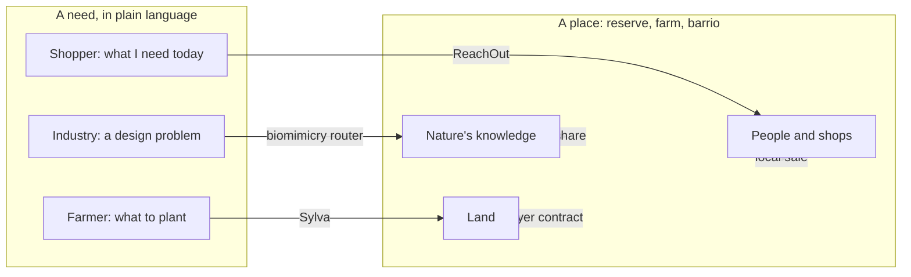

# 1. The pattern: one system, three instances

The biomimicry pitch, Sylva, and ReachOut look like three unrelated projects. They are not. They are the same machine pointed at three different flows. This chapter separates the pitch into its parts, shows that the parts are already built in the two repos, and names what each instance does alone and what they do together.

Everything in this chapter about the two codebases was read directly from the files in `ashm-023/sylva` and `Aarrushh/reachout` on 2026-10-05. Those statements are tagged [Certain]. Interpretations are tagged as such.

## 1.1 Taking the pitch apart

The biomimicry pitch, stripped to its moving parts:

| Part in the pitch | What it actually is |
|---|---|
| "Species profile: traits, components, mechanisms" | A structured record extracted from unstructured text |
| "Mapped to sectors and products" | A second index over the same records, keyed by the buyer's problem rather than the organism |
| "Tagged AI-extracted or expert-validated" | A provenance flag on every record |
| "RAG pipeline reads open research and builds the profiles" | The extraction step: corpus in, structured JSON out |
| "Search: we need a self-cleaning surface, get ranked species" | A match-and-rank step: need in, ranked sources out |
| "Companies pay for custom research" | The consulting layer is the first revenue; the database is the second |
| "Reserves join as research partners and get a share" | A value-return loop to the place the knowledge came from |
| "Start with 50 to 100 species, 1 or 2 sectors, one region" | Narrow scope, one pilot region |

So the pitch is: a grounded corpus, an extraction layer with provenance, a need-to-source matcher, a paid human layer on top, and a loop that sends money back to the source. That is the system.

## 1.2 Sylva is the same system for land

Sylva's repo does this today [Certain]:

- **Grounded corpus.** 611 species profiles extracted from World Agroforestry's Agroforestree PDF database into `data/species_db.json`, plus live site data from SoilGrids, OpenTopography, NDVI and GBIF for any coordinate.
- **Extraction layer.** `scripts/ingest_aft_pdfs.py` downloads each PDF, pulls text with pdfplumber, and asks Gemini for a fixed JSON schema (pH range, rainfall range, drought tolerance, nitrogen fixing, growth rate, uses, soil texture).
- **Match-and-rank.** `species_match_service.py` applies a hard pH filter and a weighted score (texture 15, use alignment 25, nitrogen fixing 15, degradation bonus 15). No model is involved in scoring.
- **Language layer.** `rag_service.py` retrieves knowledge chunks by keyword and asks Gemini for a transition plan, with the instruction "Do not invent species that are not in the matched list". If no key or the call fails, a deterministic plan is returned.
- **Verification hardware.** An ESP32 soil node, under 60 dollars in parts, logs moisture, temperature and optional EC so the plan is defensible for subsidies and buyers.
- **Paid layer.** The README is explicit: lead with the plan, use the hardware to make it defensible, do not pretend to be a global carbon engine.
- **Value return.** The farmer gets a plan tied to EU CAP eco-schemes and buyer contracts. The money flows toward the land, not away from it.

Two honest gaps I found while reading the data [Certain]:

1. **The provenance flag the pitch mentions does not exist yet in Sylva.** `species_db.json` has eleven fields and none of them records whether a value was AI-extracted or human-checked. The README and preprint talk about human-in-the-loop, but the data does not carry it. The biomimicry pitch's "like Sylva's validation flag" is describing something to build, not something built.
2. **The hard pH filter mostly does not filter.** In the current database, 512 of 611 species have no `soil_ph_min` and 516 have no `soil_ph_max`. The matcher treats unknown tolerance as a pass. So for 84% of species the "hard filter" is a pass-through, and the ranking is carried by texture, uses and nitrogen fixing. Rainfall ranges are better covered (117 and 142 nulls) but are not used in the current scorer at all; they are only returned. This is not a bug in the code. It is a data coverage problem that a provenance flag would make visible to the user.

## 1.3 ReachOut is the same system for everyday needs

ReachOut's repo does this today [Certain]:

- **Grounded corpus.** 3,328 real Madrid shops from OpenStreetMap, assigned to 24 barrios, with deliberately synthetic stock that is flagged `synthetic: true` on every row.
- **Extraction layer.** Stage 01 turns a plain-language need ("algo para el dolor de cabeza") into a structured intent, using only the user's words plus a committed synonym table. The LLM is optional and its output is validated against a JSON Schema before anything trusts it.
- **Match-and-rank.** Stage 03 is pure Python: in-stock rows only, whole-word match, rank by distance then stock then price. The stage document says why: "An AI guessing here would invent stock that does not exist. That is the exact failure ReachOut cannot have."
- **Routing to humans.** Every matched shop is pinged. The shopper walks there or asks for delivery. The output of a search is a trip to a neighbour, not a checkout page.
- **Honesty layer.** Every payload crosses a boundary through a schema with `additionalProperties: false`. The recommendation schema makes `confidence` and `caveat` required fields, so a recommendation without a caveat cannot be served. The dashboard shows a "practice data" banner whenever the payload says `generated_from: "fixture"`.
- **Supply-side first.** The demand service ingests public Google Trends data for a curated list of Madrid retail terms (47 seed keywords, 49 in the live run) and gives a shopkeeper something useful before they have installed anything. That is how ReachOut plans to solve its two-sided cold start.
- **Value return.** Money that would go to a warehouse goes to a shop within two kilometres.

ReachOut's one design rule is the clearest statement of the pattern in either repo: "Work that must be exact is pure Python. AI only touches language." Sylva follows the same rule in practice (scoring is rules, prose is the model) but does not state it. The biomimicry blueprint in chapter 2 adopts it as a founding rule.

## 1.4 The three side by side

| Component | Biomimicry firm (pitch) | Sylva (built) | ReachOut (built) |
|---|---|---|---|
| The place | A reserve or protected area | A farm, by coordinate | A city barrio |
| Grounded corpus | Published biology, species records | Agroforestree PDFs, SoilGrids, NDVI, GBIF | OpenStreetMap shops, live stock feed |
| Extraction | LLM reads papers into trait and mechanism records | LLM reads PDFs into agronomic records | Rule-based parser reads a query into an intent |
| Provenance flag | Planned: AI-extracted vs expert-validated | Missing today | `synthetic: true`, `source`, `generated_from`, `confidence`, `caveat` |
| The need | "We need a self-cleaning surface" | "What should I plant on this land" | "I need a USB-C charger near me" |
| Match-and-rank | Function-first index over mechanisms | pH filter plus weighted score | Distance, stock, price, deterministic |
| Where AI is allowed | Reading literature, drafting reports | Reading PDFs, drafting plans | Parsing language, phrasing results |
| Where AI is forbidden | Claiming a mechanism is validated | Scoring species | Stock, distance, price, ranking |
| Human layer | Consultants, reserve biologists | Agronomists, the farmer | Shopkeepers |
| Verification | Expert review, lab tests | ESP32 soil node, lab pH | Live inventory rows, qty >= 1 |
| First revenue | Paid research projects | Subsidy-grade plans | Retailer dashboard, then inventory sync |
| Value return | Revenue share to the reserve | Subsidies and buyer contracts to the farm | Local sales to the shop |
| Output is an action | Fund a reserve, change a design | Plant trees over 7 years | Walk to a shop |
| Pilot | Spain, 50 to 100 species, 1 or 2 sectors | Spain or Ontario, one region | Madrid, five categories |

Interpretation [Likely]: the reason the three "have the exact same format" is that each one is a router between a need and a local source, with a rule that facts come from data and only language comes from a model, and with the money moving toward the source rather than away from it.

## 1.5 What each does alone

**Sylva alone** turns a coordinate into a plan to do something slow on land. Its value is that a farmer, an agronomist and a subsidy officer can look at the same evidence. Its weakness is data coverage (see 1.2) and the fact that it is one person's project with no agronomist partners yet, which the README says itself.

**ReachOut alone** turns a need into a trip to a neighbour. Its value is that it refuses to invent facts and refuses to tell stories about shops. Its weakness is the cold start: live stock needs merchants, merchants need shoppers. The demand dashboard is the workaround. As of the repo's own context files, the demand tables hold rows from a live Google Trends backfill run in August 2026 (49 keywords), while the analytics endpoint still serves a committed fixture unless it is switched to live, and the dashboard shows a "practice data" banner whenever that is the case.

**The biomimicry firm alone** turns an industrial problem into a ranked list of organisms and mechanisms, and sends a share of the fee back to the reserve that holds those organisms. Its value is the money loop, which AskNature does not have. Its weaknesses are legal (chapter 2 covers the Nagoya Protocol and digital sequence information) and the fact that AskNature already exists and is free.

## 1.6 What they do together

Alone, each one is a niche tool. Together they are three edges of one graph:

Three things happen only when they are combined:

1. **The same reserve or region appears in all three.** A Spanish dehesa holds species that Sylva recommends to nearby farms, organisms that the biomimicry router would profile, and villages whose shops ReachOut would route to. One region, three revenue loops, one set of partners.
2. **The honesty layer becomes a shared standard.** ReachOut's schema discipline, Sylva's deterministic fallback and the biomimicry provenance flag are one idea: never let a model state a fact it did not read. Written once as a rule, it applies to all three.
3. **Each output is a thing to do, not a thing to watch.** None of the three is built to maximise time spent in the app. Sylva's output is seven years of planting. ReachOut's output is a walk. The biomimicry router's output is a design change and a payment to a reserve. That is the connection to the thesis in chapter 3 and the design in chapter 4: these are already products whose objective function is doing rather than consuming. That property is accidental in the current code. Chapter 4 makes it deliberate.

## 1.7 The one sentence

A router that takes a need in plain language, finds the nearest grounded source of an answer, lets a model only touch the language, sends the person to a human or a place to act, and routes the money back to where the knowledge lives.

Sylva and ReachOut are that sentence, built. The biomimicry firm is that sentence, pitched. The rest of this report is about what happens when you build the sentence on purpose, and point it at the thing the thesis cares about: attention, consumption and connection.
