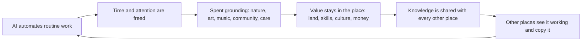
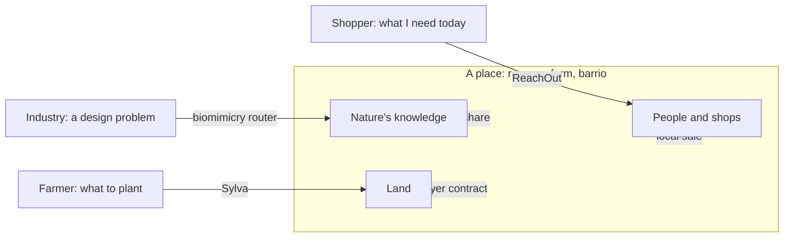

# 1. The pattern: freed time, spent on the ground

This chapter names the pattern the whole report is about. It is a pattern in people first and in software second. The human pattern comes first (1.1 to 1.6). The second half (1.7 to 1.11) shows that Sylva, ReachOut and the biomimicry pitch are early, partial builds of it.

Tags: [Certain] was read directly from a repository or primary source; [Likely] is consistent across sources but the primary was not read; [Guessing] is an inference or a belief to test. Statements of what this project believes are not tagged; they are positions, not findings. Repository facts were read from `ashm-023/sylva` and `Aarrushh/reachout` on 2026-10-05.

## 1.1 The trap

The single biggest trap of life today is that you are never grounded. Most people are more connected than any generation before, and they feel more disconnected: from their bodies, from the place they live, from the people on their street, and from any sense that what they do matters.

The feeds that fill the gap are built to hold attention, not to return it. Chapter 3 checks that claim against the evidence and finds the core of it holds: engagement-ranked feeds favour anger and out-group hostility, and people do not prefer that content [Milli 2025, Likely]. The deeper cost this project cares about is simpler. Hours spent consuming are hours not spent doing, and since we are not doing, we are struggling [Guessing, the central hypothesis of this report; chapter 4 says how to test it].

## 1.2 The pattern

Every wave of automation frees human time and attention. AI is the largest such wave yet. As more of the routine work of thinking is automated, what is left for people becomes more abstract and more creative. That can go two ways.

- **The drift.** Freed time goes back into the screen. Thought gets more abstract and less grounded. People make things they do not understand and consume things they did not choose. This is the default, because the attention economy is waiting to absorb every freed hour.
- **The turn.** Freed time goes into the healthiest life a person can live: outside, in a place, with other people, making things with their hands, caring for land, animals and each other. AI is used to equip people for that life, not to replace it.

The pattern this report is built on is the turn, and it is circular:

People invest in the future by investing in the ground under them. The return is a healthier place, which frees more time, which is invested again. Value stays local; knowledge travels.

## 1.3 What grounded means

Four anchors. A person is grounded when they have all four, and the design goal is to strengthen each one [these are working definitions, not findings]:

1. **Body.** Senses, movement, rest, time outdoors.
2. **Place.** Knowing and caring for where you live: its soil, species, seasons, history.
3. **People.** The same faces, in the same place, on a regular rhythm.
4. **Purpose.** A part to play that someone else would notice if you stopped.

## 1.4 The day we are designing for

The biggest part of the day is **doing**. A smaller part is **being**: existing, resting, grounding yourself. The smallest part is **consuming**, and that part is done with an open mind: to understand information and to see how you can contribute to it.

- **Doing** means acting with your hands or presence in a way that changes something real. Caregiving counts. Making music counts. Hustle does not count, and rest is not failure; rest is part of being.
- **The ratio is a compass, not a quota.** Each person sets their own. Nobody is scored on it.
- **Technology lives only in the consuming slice,** and its job there is to point outward, toward the doing.

## 1.5 Two balances to hold

**Creativity and understanding.** As AI does more of the making, the risk is people who can produce anything and understand nothing. The rule: AI is a lens and a teacher; the human keeps authorship. If you cannot explain what you made, you did not make it.

**Automation and stewardship.** The gains from automation should not only flow to shareholders and screens. A share should fund the work machines cannot do and people need most: stewardship of land, care, teaching, and culture.

## 1.6 AI's place in the pattern

AI can help humanity enormously, and the most important way is by equipping people to live grounded, connected and spiritual lives. In this report, real spirituality means nature, animals and love: feeling part of something larger than yourself, without doctrine, open to every faith and to none.

Three jobs, in order of importance:

1. **Point outward.** Show each person where they are needed in their own community, based on the interests and skills they already have (chapter 4, article 5).
2. **Connect people across difference through art.** History, culture and religion shown through their art, told by the communities they belong to, so people understand why others believe what they believe. The model cites its sources and never invents a tradition.
3. **Help people know their own minds.** Show people how their views and habits were shaped (by nature, by upbringing, and by the feeds they were fed) so they can choose for themselves (chapter 4, article 4).

**Local by default, global by need.** Not everything can be local, and the world stays open: trade, travel and global knowledge continue. The claim is that a life rooted in a place is a stronger way to live than the one most people have today. The method is proof, not imposition: pilot places that show it working, which other places can visit, twin with and copy.

## 1.7 The same pattern, already half built

The pattern needs a mechanism: something that takes a need and sends a person to a real place or a real person to act on it. Three projects already do this for one kind of need each. Stripped to their parts, they are the same machine [interpretation, Likely]:

| Component | Biomimicry firm (pitch) | Sylva (built) | ReachOut (built) |
|---|---|---|---|
| The place | A reserve or protected area | A farm, by coordinate | A city barrio |
| Grounded corpus | Published biology, species records | Agroforestree PDFs, SoilGrids, NDVI, GBIF | OpenStreetMap shops, live stock feed |
| Extraction | LLM reads papers into trait and mechanism records | LLM reads PDFs into agronomic records | Rule-based parser reads a query into an intent |
| Provenance flag | Planned: AI-extracted vs expert-validated | Missing today | `synthetic: true`, `source`, `generated_from`, `confidence`, `caveat` |
| The need | "We need a self-cleaning surface" | "What should I plant on this land" | "I need a USB-C charger near me" |
| Match-and-rank | Function-first index over mechanisms | pH filter plus weighted score | Distance, stock, price, deterministic |
| Where AI is allowed | Reading literature, drafting reports | Reading PDFs, drafting plans | Parsing language, phrasing results |
| Where AI is forbidden | Claiming a mechanism is validated | Scoring species | Stock, distance, price, ranking |
| Human layer | Consultants, reserve biologists | Agronomists, the farmer | Shopkeepers |
| Output is an action | Fund a reserve, change a design | Plant trees over 7 years | Walk to a shop |
| Value return | Revenue share to the reserve | Subsidies and buyer contracts to the farm | Local sales to the shop |

Each is a router between a need and a local source, with a rule that facts come from data and only language comes from a model, and with money moving toward the source rather than away from it. ReachOut states the rule outright: "Work that must be exact is pure Python. AI only touches language." [Certain]. Sylva follows it in practice (scoring is rules, prose is the model) without stating it [Certain].

## 1.8 What each does today

**Sylva** turns a coordinate into a plan to do something slow on land [Certain]. 611 species profiles were extracted from World Agroforestry's Agroforestree PDFs into `data/species_db.json` by `scripts/ingest_aft_pdfs.py` (pdfplumber plus Gemini, fixed JSON schema). `species_match_service.py` applies a hard pH filter and a weighted score (texture 15, use alignment 25, nitrogen fixing 15, degradation bonus 15), with no model in the scoring. `rag_service.py` asks Gemini for a transition plan with the instruction "Do not invent species that are not in the matched list", and returns a deterministic plan when there is no key. An ESP32 soil node, under 60 dollars in parts, logs moisture and temperature so the plan can back a subsidy claim.

**ReachOut** turns a need into a walk to a neighbour [Certain]. 3,328 real Madrid shops from OpenStreetMap across 24 barrios, with synthetic stock flagged `synthetic: true` on every row. A plain-language need becomes a schema-validated intent; matching is pure Python (in stock, whole-word, ranked by distance then stock then price); every match is pinged. Every payload crosses a boundary through a schema with `additionalProperties: false`, and a recommendation without a `caveat` cannot be served. It built the merchant side first, from public search-demand data, to solve its two-sided cold start.

**The biomimicry firm** would turn an industrial problem into a ranked list of organisms and mechanisms, and send a share of the fee back to the reserve that holds them. It is pitched, not built; chapter 2 is its blueprint.

## 1.9 Two honest gaps

Found while reading Sylva's data [Certain]:

1. **The provenance flag the pitch mentions does not exist yet in Sylva.** `species_db.json` has eleven fields and none records whether a value was AI-extracted or human-checked. The biomimicry pitch's "like Sylva's validation flag" describes something to build, not something built.
2. **The hard pH filter mostly does not filter.** 512 of 611 species have no `soil_ph_min` and 516 have no `soil_ph_max`, and the matcher treats unknown tolerance as a pass. For 84 percent of species the "hard filter" is a pass-through. Rainfall ranges are better covered (117 and 142 nulls) but are not used in scoring. This is a data coverage problem that a provenance flag would make visible.

These matter to the pattern. A system that sends people to act on the ground has to be honest about what it actually knows.

## 1.10 What they do together

1. **The same place appears in all three.** A Spanish dehesa holds species Sylva recommends to nearby farms, organisms the biomimicry router would profile, and villages whose shops ReachOut would route to. One region, three loops, one set of partners. That makes it a candidate pilot place: somewhere to prove the pattern rather than argue for it.
2. **The honesty layer becomes a shared standard.** ReachOut's schema discipline, Sylva's deterministic fallback and the biomimicry provenance flag are one idea: never let a model state a fact it did not read.
3. **Each output is a thing to do, not a thing to watch.** Sylva's output is seven years of planting. ReachOut's is a walk. The biomimicry router's is a design change and a payment to a reserve. None is built to maximise time in the app. That property is accidental in the current code. Chapter 4 makes it the point.

## 1.11 The one sentence

Use the time AI frees to ground people in their bodies, their place, each other and a purpose; build tools that turn a need into an action in a real place with real people; keep the value local and share the knowledge with everyone.

Sylva and ReachOut are early builds of the second clause. Chapter 4 is the manifesto for the whole sentence.
