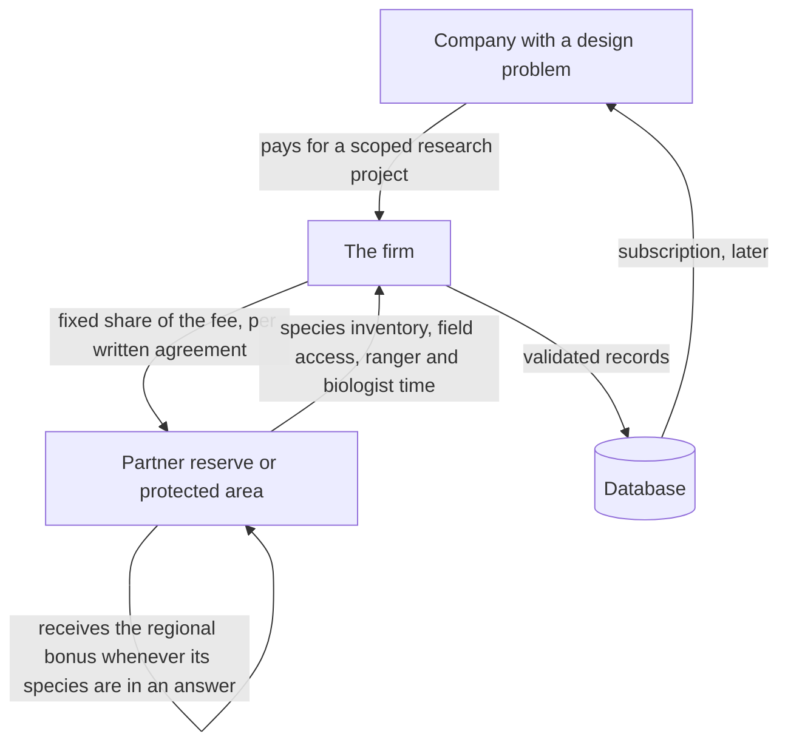

# 2. Blueprint: the second database, built on Sylva's principle

This chapter is the "separate repo" the brief asked for, written as a plan rather than code. It describes a biomimicry intelligence database and consulting service that reuses Sylva's pipeline, adopts ReachOut's honesty rules, and adds the one thing neither has: a loop that sends money back to the place the knowledge came from.

Note added 2026-10-10: decisions since this chapter was written change two things. The firm is an arm of Sylva, not a separate repository or company, and the database is completely open, with a second open database mapping industry R&D by sector. Read "subscription database" below as "open database with paid services on top". Chapter 7 is the current build plan.

Tags: [Certain] means read directly from the repos or a primary source during this session. [Likely] means consistent with several sources but not read at the primary source. [Guessing] means my own estimate; verify before relying on it.

## 2.1 What it is, in one paragraph

A company asks a question in plain language: "we need a surface that sheds dirt without detergent." The system returns a ranked list of organisms and the documented mechanisms behind each, each record carrying a provenance flag (AI-extracted or expert-validated), a confidence level, and the papers it came from. A consultant turns the top candidates into a paid report. A share of the fee goes to the reserve or protected area whose species appear in the answer, under a written agreement signed before any research starts. Over time the validated records become a subscription database. The first version covers 50 to 100 species, one or two sectors, one region.

## 2.2 Why Sylva's pipeline transfers directly

Sylva's ingestion script already does the hard part [Certain]: fetch a document, extract its text, ask a model for a fixed JSON schema, save incrementally, resume on failure, back off on rate limits. The only things that change are the corpus, the schema and the prompt.

| Sylva step (today) | Biomimicry step (change) |
|---|---|
| Species index with PDF URLs from Agroforestree | Species list from a reserve's own inventory plus GBIF occurrence records inside the reserve polygon |
| Download PDF, pdfplumber text | Download open-access papers (PDF or XML), same text step |
| Prompt: "extract pH, rainfall, uses..." | Prompt: "extract trait, structure, mechanism, function, measured performance, and the exact sentence that supports each" |
| Output `species_db.json`, 11 flat fields | Output one record per mechanism, not per species, with provenance and citations |
| `species_match_service.py`: pH filter plus weighted score | Function-first matcher: filter by sector constraints, score by evidence strength and mechanism fit |
| `rag_service.py`: plan prose, "do not invent species not in the matched list" | Report prose with the same rule: "do not cite a mechanism not in the retrieved records" |

Where to get the corpus [Likely, verify each]: OpenAlex (free scholarly metadata API with open-access filters), Europe PMC (free REST API with full text for open-access life-science articles), CORE (open-access aggregator), and GBIF for occurrence records by polygon. I could not fetch the API documentation from this session because those domains were blocked by the network proxy, so check the exact endpoints and terms before building. Sylva already calls GBIF for species observed near a farm, so that client exists [Certain].

## 2.3 The record: one mechanism, not one species

Sylva's record is one species with flat fields. That is right for agronomy, where a farmer picks a tree. It is wrong for biomimicry, where a buyer picks a mechanism and the species is the carrier. A single species can hold five mechanisms in five sectors. So the unit of the database is the mechanism.

```json
{
  "mechanism_id": "mech-00042",
  "species": "Nelumbo nucifera",
  "common_names": ["sacred lotus"],
  "trait": "leaf surface",
  "structure": "micro-papillae covered in epicuticular wax crystals",
  "mechanism": "high contact angle causes water droplets to roll and carry particles away",
  "function_tags": ["protect from physical harm", "keep clean", "manage liquids"],
  "sector_tags": ["construction", "packaging", "coatings"],
  "performance": {
    "metric": "water contact angle",
    "value": null,
    "units": "degrees",
    "measured_in": "literature, not reproduced"
  },
  "evidence": [
    {
      "doi": "10.1007/s004250050096",
      "supporting_sentence": "copied verbatim from the paper",
      "open_access": true
    }
  ],
  "provenance": {
    "status": "ai_extracted",
    "extracted_by": "model name and date",
    "validated_by": null,
    "validated_on": null
  },
  "confidence": "medium",
  "caveat": "Extracted from literature; not reproduced in a lab; not design advice.",
  "known_products": ["exterior paints marketed on the lotus effect"],
  "source_region": {
    "reserve_id": null,
    "note": "lotus is not native to the pilot region; shown as a schema example"
  }
}
```

Design rules carried over from the two repos:

- **`provenance.status` is an enum** with three values: `ai_extracted`, `expert_validated`, `disputed`. This is the flag the pitch describes. It does not exist in Sylva today (chapter 1), so build it here first and backport it to `species_db.json` [Certain that it is missing].
- **`confidence` and `caveat` are required**, copied from ReachOut's recommendation schema, where a record without a caveat cannot validate and so cannot be served [Certain].
- **`additionalProperties: false`** on every schema, ReachOut's hallucination gate [Certain].
- **`performance.value` may be null.** A null is more honest than a number the model guessed. ReachOut's demand service stores `growth_pct = null` when Google returns a label instead of a number, rather than inventing a figure [Certain]. Same rule.
- **`supporting_sentence` is copied, never paraphrased.** A reviewer can check a record in ten seconds by reading the sentence against the paper.

## 2.4 The matcher: function first, evidence second

The buyer's question is about a function, not an organism. So the index is built on function tags, which is also how AskNature organises its content by what the organism does rather than what it is [Likely; chapter 7 of the sources file has what the research agent verified about AskNature's taxonomy].

Scoring, mirroring Sylva's weights [proposal, not verified by use]:

| Stage | Method | Points |
|---|---|---|
| Hard filter | Function tag matches the parsed need | pass or fail |
| Hard filter | Sector constraints the buyer states (operating temperature, scale, toxicity) are not contradicted by the record | pass or fail |
| Soft score | Evidence strength: number of independent papers, at least one with measured performance | 0 to 30 |
| Soft score | Provenance: expert-validated 25, AI-extracted 10, disputed 0 | 0 to 25 |
| Soft score | Mechanism fit: how specific the mechanism is to the stated function | 0 to 20 |
| Soft score | Manufacturability signal: a known product or patent already exists | 0 to 15 |
| Soft score | Regional bonus: the species occurs in a partner reserve | 0 to 10 |

The language step comes after ranking, as in both repos. The model may phrase the report. It may not add a mechanism, a number or a species that is not in the retrieved records. Sylva's prompt already has this clause [Certain]; keep it word for word.

## 2.5 The money loop

This is the part AskNature does not do and the reason the company exists.



Pricing [Guessing; these are placeholders to argue about, not market data]: a scoped research project of two to six weeks priced in the low tens of thousands of euros; a reserve share in the range of 10 to 20 percent of project fees where the reserve's species or staff were used; the subscription deferred until a few hundred validated records exist. Revenue starts with consulting, as the pitch says, because the database is not worth paying for until it is validated.

What the reserve actually contributes is not genetic material. It is three things: a trustworthy species list for its territory, physical access for photography and non-destructive observation, and staff time for validation. That matters for the legal section below.

## 2.6 Where to innovate

Each of these is something neither AskNature nor the two repos does today [interpretation; AskNature facts are in the sources file].

1. **Provenance as a product.** Sell the flag, not just the content. A buyer pays more for `expert_validated` and can filter on it. AskNature's entries are curated but do not carry a machine-readable extracted-vs-validated status that a buyer can query, as far as the research agent could verify.
2. **Sector-first indexing.** Build the index from the buyer's constraint language (temperature range, cost ceiling, regulatory class) rather than from the organism. The function taxonomy is the bridge; the sector constraints are the filter.
3. **Supporting-sentence discipline.** Every record carries the exact sentence from the paper. This makes expert validation fast and makes the extraction auditable. It is cheap to implement in the existing ingestion script.
4. **The reserve as research partner, with a signed agreement first.** No reserve, no record. This is slower than scraping the literature for every organism on Earth, which is exactly why it is defensible: it produces consent, regional grounding and a story a buyer can repeat.
5. **A physical verification layer where possible.** Sylva uses a soil node to make a plan defensible [Certain]. The equivalent here is a small set of reproducible bench measurements (contact angle, adhesion, drag) done with a university partner on the ten most-requested mechanisms. A record that moves from "literature" to "reproduced" is worth more.
6. **Cross-link to Sylva.** A species in `species_db.json` that also appears here gets a second life. A dehesa oak is an agroforestry recommendation in Sylva and a cork-bark insulation mechanism here. One ingestion, two products.
7. **Honest nulls as a feature.** Publish the coverage statistics (how many records have measured values, how many are validated) on the product page. Sylva's data would show 84 percent missing pH ranges if it did this [Certain]; the fact that nobody can see that today is the problem this fixes.

## 2.7 Legal map: physical traits first, and why

The pitch's instinct is right: start with physical traits, and build consent into every reserve partnership. Here is what the law actually says, as far as the research agent could verify from legal summaries and quoted text. None of this is legal advice. The agent could not open the primary legal texts directly (the network proxy blocked them), so every point is [Likely] unless marked otherwise, and the gaps are named.

**The Nagoya Protocol.** Adopted in 2010, in force since 12 October 2014. It covers "genetic resources" and traditional knowledge associated with them. The key definition is Article 2(c): utilisation means "research and development on the genetic and/or biochemical composition of genetic resources" [Likely, text quoted in several sources]. The EU implements it through Regulation 511/2014 (due diligence for EU users) and a 2021 Commission guidance document which says, among other things, that "mere taxonomic identification" is not research and development [Likely].

**What that means for this database.** Copying a shape, a surface structure or a mechanical architecture from published literature, with no specimen collection and no work on genetic or biochemical composition, does not fit the definition of utilisation. The research agent found no legal commentary specifically on biomimicry of morphology, which means the question is unsettled in the literature it could reach rather than settled in the firm's favour. Treat "physical traits from literature are outside scope" as a reasoned reading to confirm with a lawyer, not a fact [Guessing until confirmed].

**Where it stops being clear.** Four places pull a biomimicry record into scope:

1. The trait is chemical. Lotus wax, mussel adhesive proteins, spider silk, antimicrobial peptides and pigments are biochemical composition. The example record in 2.3 names a structure (papillae and wax crystals) and a physical mechanism (contact angle). The moment a record describes the wax's chemistry and a customer develops from it, the record is at the edge of utilisation. So tag every trait `morphological`, `biochemical` or `genetic`, and gate the last two behind legal review.
2. Someone collects specimens. Spain's Real Decreto 124/2017 regulates access to genetic resources from wild taxa, with the autonomous communities as competent authorities and the environment ministry as focal point [Likely]. Observation and photography for a literature-based record are not access; collecting a sample for the firm's own bench measurements may be.
3. The species-to-function link comes from traditional knowledge rather than peer-reviewed science. Nagoya Article 7 and the EU regulation's Article 4 then apply even without genetic work. Quarantine such records.
4. A customer takes the pointer and goes on to sequence or collect. The customer becomes the user. The firm's terms need a no-reliance clause and a compliance warning.

**Digital sequence information and the Cali Fund.** At COP16 in Cali (October to November 2024) the parties set up a multilateral mechanism for benefit-sharing from digital sequence information and the Cali Fund, formally launched in Rome on 25 February 2025. Companies above size thresholds in sectors that use sequence data are expected, voluntarily, to contribute 1 percent of profits or 0.1 percent of revenue, with at least half the fund going to Indigenous Peoples and local communities [Likely]. As of August 2026 the fund had received roughly 6,000 dollars in total, the first 1,000 dollars from a small UK AI company in November 2025, against an expected scale of about a billion dollars a year [Likely]. COP17 in Yerevan, scheduled for 19 to 30 October 2026, is due to set the implementation methodology. Two consequences: morphology from literature is not sequence data, so nothing here triggers the Cali Fund; and this project's reserve payments should not be called "benefit-sharing", because that phrase imports a regulatory regime that does not apply. Call it a licence royalty or a conservation contribution, in a plain contract.

**AskNature's licence.** AskNature content is stated to be under a Creative Commons Attribution-NonCommercial licence [Likely]. A commercial database cannot reuse its texts. Using it as a discovery index and then re-deriving each fact from the primary paper is defensible and should be documented. There is no public API; a 2024 academic project did structure AskNature with a language model into a semantic network, but non-commercially [Likely].

**A warning that applies to Sylva today.** The Agroforestree Database that Sylva's 611 records were extracted from carries a 2009 World Agroforestry Centre all-rights-reserved notice, and the research agent found no open licence for its content [Likely]. Extracting facts is one thing; redistributing a structured derived table, and the 609 source PDFs that are committed in this repository's `agroforestree_data/pdfs/` folder [Certain], may infringe copyright and the EU's database right. The fix is to ask CIFOR-ICRAF for written permission (many of their publications are openly licensed, so this is plausible), remove the cached PDFs from the public repository in the meantime, and in the long run rebuild from openly licensed sources. The biomimicry database should start with that permission question answered, which is why its corpus is open-access literature by design.

**Who can receive the money.** Spanish national parks are administered by the autonomous communities with state funding through the national parks agency; regional natural parks sit in regional budgets [Likely]. A public administration may not be able to accept earmarked private revenue directly. The research agent could not get park-level budgets. Expect the payment to go through a foundation or an authorised sponsorship channel, and verify the reserve's legal capacity before the agreement is signed.

**Needs a lawyer before launch:** any biochemical or genetic record; database and text-and-data-mining rights for publisher content; the contract form with a public reserve; state-aid and procurement questions if the reserve co-develops or endorses the product; product-liability and no-reliance language for engineering advice; and any "nature-positive" marketing claim under EU green-claims rules.

## 2.8 Why AskNature does not already do this

AskNature is the obvious objection. It is run by the Biomimicry Institute, launched in 2008, lists more than 1,700 biological strategies organised by function and more than 200 innovation records (the Institute's own figures, date unverified), is free, and added an AI chat layer in September 2025 [Likely]. It is philanthropically funded, mainly by one foundation, and has no earned-revenue model that the agent could find [Likely].

The pitch's three differences hold up, with one correction:

- **AI-built**: partly true as a difference. AskNature is curated by hand and now has a chat layer on top; a 2024 academic project already used a language model to turn its content into a knowledge graph. The real difference is not "AI" but the provenance flag and the supporting sentence on every record, which AskNature does not expose as queryable data as far as the agent could verify.
- **Sector-first**: true. AskNature's index is function-first by organism strategy; buyer constraints (temperature, cost, regulatory class) are not part of its model.
- **Funding-linked**: true, and it is the whole point. No money flows from AskNature to any place. Correction added 2026-10-09: the Biomimicry Institute itself has routed proceeds from bio-inspired products to conserving the copied organisms' habitats, as a nonprofit programme whose current status is unconfirmed; no commercial consultancy was found that builds a reserve payment into every contract (chapter 6.5).

Two cautions from the case-study record. First, popular biomimicry stories are often wrong or oversold: the Eastgate Centre's termite-mound ventilation was shown in 2008 to rest on a mistaken idea of how mounds work; Speedo's shark-skin suit was found in 2012 not to reduce drag the way shark skin does; the Shinkansen efficiency figures trace back to talks, not an independent study [all Likely]. A database that repeats these without an evidence grade will embarrass its buyers. Second, the one well-known case of "research pays the reserve", the Merck and INBio agreement in Costa Rica from 1991, produced no products and no royalties in a decade, and INBio handed its collection to the state in 2015 [Likely]. That failure was in drug discovery, where timelines are long and hit rates low. Design and materials consulting pays in weeks, not decades, which is the reason the money loop here can work where bioprospecting did not. It is also the reason not to promise a reserve anything beyond a share of fees actually received.

The market-size figure that circulates (biomimicry worth 425 billion dollars of US GDP by 2030) is a 2013 projection commissioned by an interested party [Likely]. Do not put it in a pitch deck.

## 2.9 What the first six months look like

1. One reserve or natural park, one signed agreement, one biologist's time.
2. A species list for that territory, cross-checked against GBIF occurrences inside its boundary.
3. The ingestion script from this repository, pointed at open-access literature for those species, with the mechanism schema and the supporting-sentence rule.
4. One industrial question from one company, answered as a paid report with a visible evidence grade on every mechanism.
5. The twenty most useful records validated by the biologist and marked `expert_validated`.
6. A public coverage page: records, validated share, measured-value share, open questions.

If step 4 cannot find a company willing to pay, that is the result. The brief asked how this could work and why it will. The honest answer is that it works if a buyer pays for a validated answer that also funds the place it came from, and that this has not yet been tested. Steps 1 to 6 are the test.
