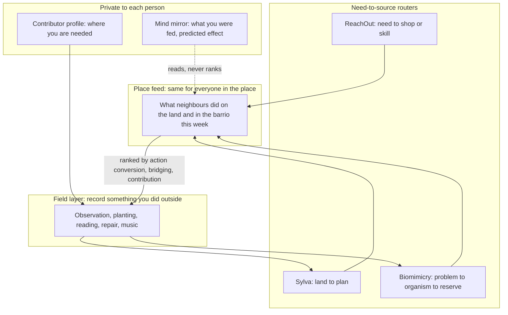

# 4. The grounding manifesto: an algorithm for doing

This chapter is a manifesto, not a product spec. It says what a social algorithm should be for, if the goal is people who are grounded, doing, empathetic and free to think for themselves. The mechanics come last (4.5), short, and built only from parts that exist in the two repos or in verified research.

Tags: [Certain] read from a repository or primary source; [Likely] consistent across sources but the primary was not read end to end; [Guessing] an inference or a hypothesis to test. The articles themselves are positions and are not tagged. Citation keys in brackets point to `SOURCES.md`.

## 4.1 What we believe

**The trap is never feeling grounded.** People are surrounded by connection and starved of it: cut off from their bodies, their place, their neighbours and any sense that what they do matters. Chapter 1 names the four anchors a grounded life needs: body, place, people, purpose.

**Today's feeds deepen the trap, by design of the metric.** An engagement-ranked feed shows you more of whatever you will click, watch or reply to. Moral and emotional language spreads further [Brady 2017, Likely]. Posts about the political out-group draw far more engagement than posts about the in-group [Rathje 2021, Likely]. Engagement-ranked feeds show users more divisive content than a chronological feed, and users do not report liking it more [Milli 2025, Likely]. Nobody had to plan this; the metric selects for it.

**Since we are not doing, we are struggling.** The cost of a feed is not only what it shows. It is the hours it takes from doing things with your hands, in a place, with people. That is the central hypothesis of this report [Guessing], and it is testable (4.7). We do not claim empathy is collapsing; the best data says it has been rising since 2009 [Konrath 2025, Likely]. We claim something simpler: a grounded life is a better life, and almost nothing in our technology is built to lead people toward one.

**AI has reached the point where it can help humanity incredibly.** The highest use of that help is to equip people to live grounded, connected and spiritual lives: back in nature, making art and music, understanding their communities, believing in goodness and in their own power to do good.

## 4.2 The day we design for

- **Most of the day: doing.** Acting with your hands or presence on something real. Caregiving counts. Music counts. Hustle does not.
- **Less of the day: being.** Existing, resting, grounding yourself. Rest is part of a grounded life, not a failure of it.
- **The least of the day: consuming.** And when you consume, with an open mind: to understand, and to see how you can positively contribute.

This ratio is a compass, not a quota. Each person sets their own. An algorithm lives only in the consuming slice, and its whole job there is to point outward.

## 4.3 The twelve articles

### Article 1. Light up innovation, empathy and care, not attention

A social algorithm is a machine for deciding what a mind meets next. Today that machine is tuned for attention. We want it tuned for the capacities that make people better neighbours: curiosity and invention, understanding of others, and care.

We do this through what can be seen and checked, not by steering anyone's brain in secret. Innovation shows up as people making things. Empathy shows up as people who usually disagree finding the same thing useful. Care shows up as someone helping someone else, verified in the world. Those are the ranking signals (4.5). Brain science informs the design and audits the result (Article 4); it never becomes a hidden dial.

### Article 2. Widen, don't harden

A feed that only confirms what you already believe hardens you. But the obvious fix fails: in a month-long field experiment, Twitter users paid to follow a bot that retweeted the other side became more entrenched; Republicans became substantially more conservative [Bail 2018, Likely]. Opposing posts alone are not exposure; they are provocation.

So we widen views three ways:

1. **Understand why others believe.** Show a view through the history, art and lived experience behind it, told by the people who hold it, not through its angriest post.
2. **Rank for bridging.** Surface what people who usually disagree both rate useful. Re-ranking real feeds by animosity changed how warmly people felt about the other side, in either direction [Piccardi 2025, Likely], and re-ranking for bridging reduced polarisation with little change in time spent [PRC 2026, preprint, Likely].
3. **Do things together.** Across 515 studies, contact between groups typically reduces prejudice, most strongly when people meet with equal status, a shared goal, cooperation and support from the institutions around them [Allport 1954; Pettigrew 2006, Likely]. Planting a hedgerow together does what no post can.

### Article 3. Real over aesthetic

We are more than the aesthetics we crave to be online. Feeds that reward polish teach people to curate a life instead of living one.

No ranking signal rewards production value, filters or follower counts. Process beats product: the hands, the mud, the first attempt, the repair. A person is visible for what they have done and shown, not for how it looked.

### Article 4. Know your own mind

Every person's views were shaped: by their nature, by their upbringing, and, now, by the feeds that chose what they saw. A free person can see that shaping. Nobody is unbiased, and people reliably see bias far more easily in others than in themselves [Pronin 2002, Likely]. The goal is a population aware of its biases.

Three tools:

1. **The mind mirror.** A private, regular report of what you were fed: topics, sources, emotional tone, time, and the predicted effect of that diet. Brain-encoding models now make the last part possible. Meta's TRIBE v2, announced in March 2026, predicts how the human brain responds to video, audio and text; it was trained on over 1,000 hours of fMRI across 720 subjects and is built for "in silico" experiments that need no scanner [TRIBE v2 2026, Likely]. A mirror built on such a model could tell you, in plain words, that most of what you watched this week is the kind of content predicted to engage threat and outrage, and very little the kind predicted to engage curiosity.
2. **Bias teaching and prebunking.** Short lessons in how manipulation works, given before people meet it. In six experiments (6,464 people) and a YouTube field study (22,632 people), short prebunking videos improved people's ability to recognise manipulation techniques, across the political spectrum [Roozenbeek 2022, Likely].
3. **The trace.** For any view you hold strongly, a way to see how it reached you: which sources, which feeds, which people.

**The mirror is a mirror, not an engine.** These rules are not negotiable:

- Predicted brain response is never a ranking signal, never used to steer a person, never sold.
- Predictions describe content, averaged over many brains. They are not a reading of you. A region lighting up does not prove a feeling; inferring a mental state from activation is the reverse-inference problem [Poldrack 2006, Likely]. The mirror says "predicted to engage", never "you felt".
- The mirror is trusted only where its predictions agree with what people actually do and report offline. Where they disagree, the mirror says so.
- The same model doubles as a public **audit tool**: run it over samples of any platform's feed and publish what that feed is, in effect, optimising for. The EU already gives vetted researchers access to platform data for this kind of work [DSA Art. 40, Likely].
- TRIBE v2's weights are released under CC BY-NC 4.0, non-commercial only [TRIBE v2 2026, Likely]. Research and public audits fit that; a commercial product needs a licence or its own model.

### Article 5. Every person has a call to action

Platforms already know a great deal about each person's interests and skills. Today that knowledge is used to sell to them. We flip it: the consumer profile becomes a contributor profile. Same data, opposite goal.

The algorithm's question is not "what will keep you here?" but "where are you needed?". You have spent forty hours watching irrigation videos; the community garden two streets away needs someone who understands irrigation. You play guitar; the care home on your road wants music on Thursdays.

- The profile is opt-in, visible to you in full, editable, deletable, and never sold.
- Every hard story in the feed ships with one local action. Helplessness comes from bad news with nowhere to go.
- Small, visible, local wins come first. People believe they can have an impact when they see their own impact. In a study of 343 Chicago neighbourhoods, those where residents trusted each other and expected to act together had less violence, even after accounting for poverty [Sampson 1997, Likely]. That collective efficacy is built, not announced.

### Article 6. Ground people in body, place, people and purpose

- **Nature, built through feeling, not facts.** Feeling connected to nature, not minutes outdoors, predicts wellbeing [Richardson 2021, Likely], and connection is built through contact, emotion, beauty, meaning and compassion [Lumber 2017, Likely]. People reporting at least 120 minutes a week in nature report better health and wellbeing, as an association, not a dose [White 2019, Likely].
- **Animals as a pathway.** Noticing, recording and caring for animals is one of the most direct routes to empathy and grounding most people have. Observation scales: iNaturalist passed about 300 million observations and eBird two billion [iNaturalist 2026; eBird 2025, Likely]. Honesty: the claim that owning a pet makes people healthier is an unproven hypothesis [Herzog 2011, Likely], and a 2021 systematic review found mixed results [Scoresby 2021, Likely]. The claim here is about attention to and care for animals, not ownership.
- **Same people, same place, weekly rhythm.** Loneliness is fought with repetition, not reach. Across 148 studies, people with stronger social relationships had a 50 percent increased likelihood of survival [Holt-Lunstad 2010, Likely; an odds ratio of 1.50].
- **Music and art as making.** The feed points to the choir, the jam, the workshop, the mural. Watching is the doorway, not the room.
- **Stewardship.** Purposeful group work outdoors shows the strongest programme results and the weakest evidence quality [GSP evaluation 2024; Husk 2016, Likely]. Sylva's planting plan and soil node are literal stewardship tasks [Certain], which makes them a way to test this rather than assume it.

### Article 7. Connect the world through art

AI can be the clearest guide yet into how every culture sees the world: its history, its beliefs and its religions, shown through the art those communities made. Understanding why others believe is the root of empathy across difference (Article 2).

- Communities tell their own story. The model cites, translates and connects; it never invents a tradition.
- Sacred material is shown only with the consent of the people it belongs to.
- Every claim carries its source, as every record in Sylva and ReachOut should (chapter 1).

### Article 8. Local by default, global by need. Prove it, don't impose it

All-local may not work, and it does not need to. Trade, travel and the global exchange of knowledge stay. Decisions sit at the most local level that can handle them. Communities can govern shared resources well when they set the rules themselves [Ostrom 1990, Likely].

We do not impose this. We prove it: pilot places that show a grounded, local life is a stronger way to live than the one most people have now, open for anyone to visit, twin with and copy. Local never means closed. A place that turns against outsiders has failed this article.

### Article 9. The hardest case first

A doing-first design can quietly serve only the able, the rural and the time-rich. So every feature is designed first for the hardest case: the city poor with no garden, the disabled, the elderly, the shift worker with one free hour. Children learn outside; elders teach. If it does not work for them, it does not ship.

### Article 10. The app that wants you to leave

The best session ends with the phone in a pocket and the person somewhere else. Success is people needing the app less over time.

We measure people, not usage: connectedness to nature [Mayer 2004, Likely], loneliness, belief that neighbours act together, trust. Daily active use is not a goal. Time to close the app after an action is a success metric.

### Article 11. Never sell attention

No ads, ever. The moment attention is the product, every article above bends. Revenue comes from those who benefit from people doing: municipalities (as they fund libraries), health systems (as they fund social prescribing), local businesses (tools, not ads), and steward-owned or cooperative structures that cannot be sold to someone who would flip the metric.

A share of what automation saves should fund stewardship, care, teaching and culture. And the AI itself stays small: the smallest models that do the job, run locally where possible, with their footprint published.

### Article 12. No guru. State how we could be wrong

This is not a movement with a leader. It is a set of claims that can fail. Section 4.8 lists what would prove this manifesto wrong. If those results arrive, the design changes.

## 4.4 The population we are working toward

A conscious, educated, informed population, aware of its own biases, living in real places with real people, and focused on real spirituality: nature, animals and love. People who look into the psychology of their own minds, understand their nature, their nurture and how parts of their views were engineered, and find their call to action in the community around them.

## 4.5 How it could work

The mechanics are deliberately short and deliberately boring. Each one already exists in part.

**The place feed.** The unit of personalisation is the place, not the person. Everyone in the same barrio, reserve buffer zone or soil-and-climate zone sees the same feed. This restores shared reference points and is the cheapest privacy design, because the system needs to know where you are, not who you are. ReachOut already assigns shops to 24 barrios and scopes streams by region; Sylva's plan is a function of coordinates [Certain]. Personal tools (the mind mirror, the contributor profile) are private and separate from the shared feed.

**Three ranking signals, none of them attention:**

1. **Action conversion.** Did the item lead to a verified action off screen: a pickup at a shop, a soil node installed, a tree planted, a repair done? This is the primary signal.
2. **Bridging.** Was the item rated useful by people who usually disagree? This is the principle behind Community Notes [Wojcik 2022, Likely] and bridging-based ranking [Ovadya 2022, Likely]. Its known weakness is that it can bury a correct minority view; chapter 5 lists the mitigation.
3. **Contribution.** Did someone give something: a skill shown, an observation a ranger validated, music played at the care home? Logged as a visible record, never as a balance owed.

**The field layer.** Go outside, record something (a species, a soil reading, a repair, a planting), and it becomes a data point with a provenance flag in Sylva or the biomimicry database. A ranger's or agronomist's validation is the like button.

**Skills without ledgers.** History is blunt about this. What scaled kept money as the medium, removed the ledger, or packaged a cheap event: Buy Nothing at about 7.5 million members, more than 4,000 Repair Cafés, community supported agriculture paid up front [Likely]. Time banks, which count hours, have stayed small for forty years [Likely]. So: skills appear as gifted search results next to shops in ReachOut's pipeline; a repair-and-teach afternoon runs monthly per place from a kit; the farmers, rangers and shopkeepers are paid in euros that stay within a few kilometres. Nothing is counted.

**The mind mirror and the audit.** A private report built on a brain-encoding model, under the rules in Article 4, plus published audits of other platforms' feeds. It reads the feed; it never ranks it.

**AI reads everything and decides nothing.** Models read documents into records with provenance and a supporting sentence, turn plain speech into validated intents, and translate between cultures. Matching, ranking, money and provenance status are deterministic: "Work that must be exact is pure Python. AI only touches language." [Certain, ReachOut]. The ranking signals are published as a table anyone can read. The EU already requires platforms to explain their recommender systems and offer a non-profiled option [DSA Art. 27 and 38, Likely], and in 2026 the Commission moved against "addictive design" itself [EC 2026, Likely]. This design goes further because it can.

## 4.6 Who pays

Never advertisers. Municipalities pay for a place feed the way they pay for a library. Shopkeepers pay for ReachOut's demand dashboard. Subsidy programmes and buyers pay through Sylva's plans. Companies pay the biomimicry firm, which pays the reserve. Health systems can fund the nature and community side as social prescribing. The gifting layer is free, because the moment it is monetised it becomes the thing it was meant to replace.

## 4.7 How we will know

Each claim above is a prediction. Run each in a pilot place against a comparable control place, for at least a year [Guessing, as predictions]:

- **Grounding.** Higher connectedness-to-nature scores and more weekly hours of doing, self-reported and sampled.
- **Connection.** More offline encounters between people who did not previously know each other, measured as co-presence at verified actions; lower reported loneliness.
- **Agency.** Higher belief that neighbours act together and that one person can make a difference.
- **Widening.** Lower affective polarisation, without less time spent understanding other views.
- **Self-knowledge.** People who used the mind mirror can describe how their feed shaped them, and change what they consume.
- **Less app.** Falling time in the app alongside rising verified actions.

## 4.8 What would prove this wrong

- People in the pilot place do more and feel no better. Then doing is not the missing piece.
- The place feed is visited once and never again. Then shared reference points are not what people want.
- Contributor profiles feel like surveillance and people opt out. Then the flip from consumer to contributor fails on trust.
- The mind mirror's predictions do not match what people do and report. Then brain-encoding models are not ready to describe feeds, and the mirror is withdrawn.
- The benefits reach only the time-rich and the already grounded. Then Article 9 has failed, and so has the design.

If these results arrive, we change the design and say so in public. If the predictions hold, the pattern in chapter 1 has its proof, and the products have their reason to exist together.
