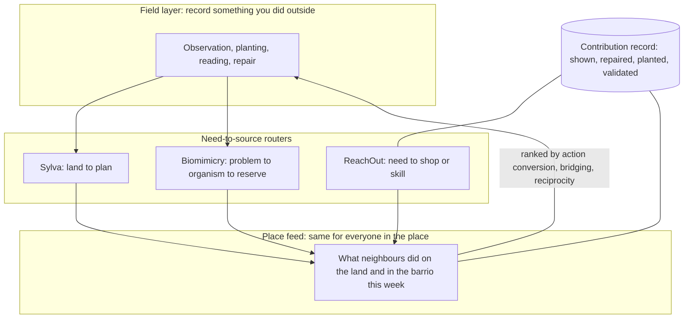

# 4. The connection algorithm: from attention to doing

This chapter answers the hardest question in the brief: how to use AI to get people back into nature and into each other, and how to re-route consumption into investing in other people's skills, by redefining what a social algorithm is built to maximise. It is a design, not a product. It builds only on parts that exist in the two repos or in verified research.

Tags: [Certain] read from a repo or primary source this session; [Likely] consistent across sources but not read at the primary source; [Guessing] my own inference. Citation keys in brackets like [Brady 2017] point to `SOURCES.md`.

## 4.1 What today's algorithm is built to maximise, and why the thesis is half right

An engagement-ranked feed predicts what you will click, watch or reply to, and shows you more of that. Content that uses moral and emotional language spreads further on social networks than neutral content [Brady 2017, Likely]. Posts about the political out-group draw far more engagement than posts about the in-group [Rathje 2021, Likely]. Engagement-ranked feeds show users more divisive content than a chronological feed would, and users do not report liking it more [Milli 2025, Likely].

That is the evidence behind the thesis's "Big 3". Anger and tribalism are directly documented. Fear is less directly measured in that literature; threat and outrage overlap but are not the same thing [Guessing]. The thesis is right that the objective function selects for these. It overstates when it says this is "deliberate" in the sense of a plan; the research supports selection by metric, not intent. The result is the same either way.

The deeper claim in the thesis, that personalisation erodes a stable self and so erodes empathy, is a hypothesis. The empathy-decline evidence usually cited is a 2011 meta-analysis of American college students that found empathic concern down 48 percent and perspective taking down 34 percent between 1979 and 2009 [Konrath 2011, Likely]. Two problems: it predates algorithmic feeds, and the same lead author's 2025 update finds both measures rising again since 2009 [Konrath 2025, Likely]. So "empathy is dying" is not what the best available data says. Chapter 3 goes through this fairly. For design purposes the thesis is useful anyway, because it names a testable variable: shared reference points.

## 4.2 The inversion: personalise the place, not the person

Every algo-rhythm being different is the thesis's sharpest observation. Two neighbours see two realities. The direct inversion is simple to state: **the unit of personalisation is the place, not the person.**

Everyone in the same barrio sees the same barrio feed. Everyone within a reserve's buffer zone sees the same reserve feed. Everyone whose farm shares a soil type and climate sees the same land feed. The feed is personal in the sense that it is about where you are. It is shared in the sense that the person next to you sees the same thing.

ReachOut already does this [Certain]: shops are assigned to 24 barrios at ingest, the inventory stream can be scoped by region, and the URL is the state of record, so two people with the same URL see the same results. Sylva already does it for land [Certain]: the recommendation is a function of coordinates, soil and NDVI, so two neighbouring farms get near-identical plans. Neither repo frames this as a social design choice. It should be the founding one.

What this restores is exactly what the thesis says personalisation destroyed: a shared reference point. It is also the cheapest possible privacy design, because the feed needs to know where you are, not who you are.

## 4.3 The objective function: predicted offline action

An attention feed maximises expected time on screen. The connection algorithm maximises expected **verified action off screen, with a person or a place.** Three things count as an action, and each of the three products already produces one [Certain]:

| Product | The action | How it is verified today |
|---|---|---|
| ReachOut | A shopper walks to a pinged shop | Live inventory row with qty >= 1; a pickup or sale closes the loop (not built yet) |
| Sylva | A farmer plants according to a phased plan | Soil node time series; lab pH at install |
| Biomimicry router | A company pays a reserve through a project | Signed agreement; fee share transferred |

Ranking rule, stated plainly: show the item that is most likely to end with the phone in a pocket and the person somewhere else. Time to close the app after an action is a success metric, not a failure. Daily active use is not a goal. Monthly verified actions per person is.

This is the opposite of what the thesis calls the comfort loop. It is also uncomfortable for a business, because it kills the advertising model on purpose. Revenue has to come from institutions that benefit from the action: municipalities and merchants (ReachOut), subsidy programmes and buyers (Sylva), companies and reserves (biomimicry). All three repos or pitches already plan for that [Certain].

## 4.4 Three signals that replace engagement

1. **Action conversion.** Did the item lead to a verified action within a time window? ReachOut's ping and pickup, Sylva's node installation, a repair done at the monthly event (4.6 below). This is the primary signal.
2. **Bridging.** Was the item rated useful by people who usually disagree? This is the idea behind bridging-based ranking [Ovadya 2022, Likely] and the algorithm behind Community Notes, which only surfaces a note when raters across different viewpoints agree on it [Wojcik 2022, Likely]. It has now been tested causally. A preregistered field experiment on X during the 2024 US campaign found that re-ranking posts by partisan animosity moved how warmly people felt toward the other party, in either direction [Piccardi 2025, Likely]. The Prosocial Ranking Challenge re-ranked the real feeds of about 9,400 US adults from August 2024 to February 2025 and reported that two arms, one of them "uprank bridging, downrank toxic", reduced affective polarisation with only small changes in time spent; that result is a March 2026 preprint and not yet peer reviewed [PRC 2026, Likely]. Applied to a place feed: a proposal to plant a hedgerow on the common land surfaces when both the farmers and the weekend walkers rate it useful. Its known weakness is that it can bury views held by a minority, however correct. Chapter 5 lists the mitigation.
3. **Contribution.** Did the person give something: a skill shown, a repair done, an observation a ranger validated, a tree planted? Logged as a visible record, never as a balance owed. The history of time banks in 4.6 says that the moment contribution becomes accounting, it stays small. A person who has shown three things is visible for that, not for followers.

None of these can be computed from watch time. That is the point.

## 4.5 Getting people back into nature: the evidence as a spec

The research on nature connectedness gives an unusually clear design brief, and it is not "put nature on a screen".

- **Connection beats minutes.** In a UK sample of 2,096 adults, time in nature was not the main predictor of wellbeing; feeling connected to nature and small sensory acts like smelling wildflowers were [Richardson 2021, Likely]. The five pathways that build connection are contact, emotion, beauty, meaning and compassion; a walk designed around them raised connection more than a plain walk in nature did [Lumber 2017, Likely]. A fact-heavy nature app is the wrong product. A noticing-and-caring product is the right one.
- **There is a threshold, but it is an association.** In a sample of 19,806 people in England, those reporting at least 120 minutes a week in nature were more likely to report good health and high wellbeing, however the minutes were split [White 2019, Likely]. The study is cross-sectional and self-reported, so it supports encouraging regular contact, not prescribing a dose.
- **Screens can push people outdoors, but attention stays on the screen.** Pokémon GO measurably increased physical activity for a while [Althoff 2016, Likely]. It did not build connection, because the object of attention was the screen. The research agent found no peer-reviewed trial showing any app increases time outdoors relative to screen time [could not verify, treat as an open question]. The lesson is not "gamify nature". It is "make the screen the way to record something you did outside, then make it go dark".
- **Purposeful group activity has the strongest programme results, and the weakest evidence quality.** England's green social prescribing test-and-learn programme supported 8,339 people with mental-health needs into nature-based activity across seven sites, 57 percent from the most deprived areas, with wellbeing scores moving from below to around national averages [GSP evaluation 2024, Likely]. The Conservation Volunteers' Green Gym evaluation of 892 volunteers found wellbeing gains largest for those who started lowest [Green Gym 2022, Likely]. Both are uncontrolled before-and-after evaluations. A Cochrane review found the quantitative evidence for conservation volunteering weak, while the qualitative evidence pointed to contribution, pride and social contact as the mechanisms [Husk 2016, Likely]. So: stewardship is plausibly the best pathway, and it is not proven. Sylva's planting plan and soil node are literal stewardship tasks [Certain], which makes them a way to test this rather than assume it.
- **Observation scales.** iNaturalist passed roughly 300 million observations around its eighteenth birthday in 2026 and eBird passed two billion bird observations in June 2025 [iNaturalist 2026; eBird 2025, both Likely]. A systematic review found participants report knowledge, attitude and behaviour change, mostly by self-report [Peter 2019, Likely]. Low-friction, no-account entry points and visible scientific use are what sustained participation. That is the model for the field layer below.

The product that follows: a **field layer** shared by all three systems. You go outside, you record a thing (a species seen, a soil reading, a repaired fence, a tree planted), and that record becomes a data point with provenance in Sylva or the biomimicry database. The feed you come back to shows what your neighbours did on the land this week, not what they bought. The expert-validated flag from chapter 2 is the status symbol. A ranger's validation of your observation is the like button.

## 4.6 Re-routing consumption into other people's skills

The brief's economic idea is that consumption should be re-routed into investing in the skill set of other people. ReachOut is already the first half of this [Certain]: a need is routed to the nearest human who can meet it, instead of to a warehouse. The second half is harder than it sounds, and the verified history says exactly how.

What has reached real scale [all Likely; figures in `SOURCES.md`]:

- **Gifting with no ledger.** The Buy Nothing Project, started on Bainbridge Island in 2013, is cited at about 7.5 million members in more than 7,500 groups across 44 countries. Nothing is counted. It rode on free existing infrastructure.
- **A cheap, replicable event.** Repair Cafés, started in Amsterdam in October 2009, passed 4,000 registered cafés in more than 40 countries. A starter kit, volunteers, a fixed object you can take home.
- **Money, paid up front.** Community supported agriculture, from Japanese teikei in the 1970s and US farms in 1986, counted about 7,244 US farms in the 2020 USDA survey. It scaled because farmers were paid in advance, in money.
- **Law.** The EU right-to-repair directive applies from 31 July 2026, and the ban on destroying unsold clothing applies to large companies from 19 July 2026.

What has stayed small, for forty years [all Likely]:

- **Time banks.** Edgar Cahn's time dollars date from 1980. The largest US network reports roughly 28,000 members in about 325 communities and 3.9 million hours exchanged in total. Spain has 200 to 300 bancos del tiempo with a few thousand active participants nationally, the first opened in Barcelona in 1998. Japan's Fureai Kippu, started in 1995 for elder care, declined after public long-term care insurance arrived in 2000. The evidence of benefit is real but low-certainty and concentrated among isolated and older members.
- **Barter for knowledge.** Trade School reached about 22,000 people in roughly fifteen cities over a decade and closed in 2019 on organiser burnout and no revenue model.
- **Platform co-ops in logistics.** The Drivers Cooperative in New York rose to about 9,000 drivers and contracted sharply in 2024; bike-courier and cleaning co-ops exist at tens to hundreds of workers.

The pattern is blunt. Models that scaled kept money as the medium, removed the ledger entirely, packaged a cheap event, or used law. Models built on reciprocal accounting of time or skills, which is the most literal reading of "invest consumption into other people's skills", have consistently stayed small, grant-dependent, and valuable for social inclusion rather than volume. A design that ignores this will join them.

So the design does not build a time bank. It makes three moves:

1. **Skills as search results, gifted.** In ReachOut's pipeline, the answer to "I need to fix my bike" can be a shop that sells the part and a neighbour who has offered to show you. Same deterministic matcher, second inventory. No hours counted. Buy Nothing's rule, applied to knowledge.
2. **Repair and teach as a monthly event on the place feed.** One afternoon a month per barrio or village, run from a kit, is the Repair Café model and the cheapest proven form of people investing in each other's skills. The place feed announces it and records what was fixed and shown.
3. **Keep money where money works.** Sylva's farmers, the reserves' rangers and the shopkeepers are paid in euros. The re-routing is of where the euro goes (to the farm, the shop, the reserve, within a few kilometres) rather than of the euro into hours. That is what CSA proved.

Liquidity, the thing that kills stand-alone exchanges, comes from the host products: a shopper looking for a charger sees a neighbour's offer next to the shop; a farmer looking for a plan sees the agronomist's open afternoon. The ReachOut cold-start lesson applies: give the supply side something useful before asking it to integrate [Certain].

Where the money goes: the platform's revenue comes from the institutions in 4.3, never from a cut of a gift. A municipality pays for a barrio feed the way it pays for a library. The shopkeeper pays for the demand dashboard. The reserve share pays the rangers. The gifting layer is free, because the moment it is monetised it becomes the thing it was meant to replace.

## 4.7 AI's role, stated narrowly

The thesis wants AI to be "the clearest natural-language navigator into how every culture views any topic", a second brain of the world rather than a replacement for everyone's thinking. The two repos show how to do that without the model inventing anything [Certain]:

1. **Read and structure.** Models read documents (PDFs, papers, field notes, oral histories transcribed) into records with a provenance flag and a supporting sentence. This is Sylva's ingestion script generalised.
2. **Translate the need.** Models turn plain speech, in any language, into a structured intent, validated by a schema, with the user's exact words preserved. This is ReachOut's stage 01.
3. **Never decide the facts.** Matching, ranking, stock, distance, money and provenance status are deterministic. "Work that must be exact is pure Python. AI only touches language."
4. **Explain the feed.** Every user can export what they were shown and why. The EU Digital Services Act already requires platforms to state the main parameters of their recommender systems in plain language, and requires the very large ones to offer at least one option not based on profiling [DSA Art. 27 and 38, Likely]. In 2026 the European Commission issued preliminary findings that TikTok's and then Meta's "addictive design" (infinite scroll, autoplay, personalised recommendation) breaches the Act, the first enforcement aimed at platform architecture rather than illegal content [EC 2026, Likely]. The connection algorithm goes further because it can: with a place feed there is no profile to hide, and the ranking signals in 4.4 can be published as a table.

That is the thesis's algorithmic-transparency demand (Part 7.2) turned into a product property rather than a regulatory ask.

## 4.8 How the three products plug in

Each router keeps its own deterministic core and its own schemas. The place feed is a thin layer that reads their outputs. The field layer is the only new thing, and it is mostly a form with a provenance flag. The contribution record is a log, not a ledger: it has no balances.

## 4.9 What this does to the thesis's mechanism

The thesis says: no sense of self, so no self-with-others, so no empathy. Three design choices above act on each link, and each one is testable [Guessing, as predictions]:

- **Self.** A place feed stops re-inventing who you are every scroll, because it is about where you are. Prediction: lower self-reported identity churn after three months, measured with existing scales.
- **Self with others.** Shared reference points return because neighbours see the same feed. Prediction: more offline encounters between people who did not previously know each other, measured as co-presence at verified actions.
- **Empathy.** Stewardship and skill reciprocity are the pathways the nature-connection literature names (compassion, meaning). Prediction: higher nature-connectedness scores and higher reported trust in neighbours, against a control barrio.

If the predictions fail, the design is wrong and the thesis is still interesting. If they hold, the thesis has its proof-of-concept and the three products have their reason to exist together.
