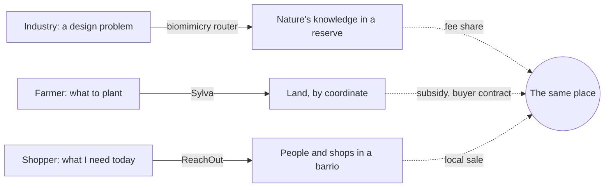

# Freed time, spent on the ground

**A report connecting Sylva, ReachOut, the biomimicry intelligence firm, and the consciousness thesis.**
Written 2026-10-05. Chapters 1 and 4 rewritten 2026-10-08 around the author's grounding thesis: chapter 1 now leads with the human pattern, and chapter 4 is a manifesto. Chapters 1 to 5 and the sources file hold the depth; this document is the whole argument in one sitting. On 2026-10-09 the plan this report serves was added as chapter 0, and the business and ethics of the nature-in-industry firm as chapter 6.

**The plan in brief (chapter 0).** The goal is to reroute today's consumption loop into doing. Four parts reach it. **Land:** Sylva, a farm dashboard paired with a field robot, proves that regenerative farming and agroforestry keep soil healthier and earn farmers the subsidies they are owed, with a transition roadmap and financial help; live now. **Industry:** a nature-in-industry firm helps companies look to nature first, through biomimicry and nature-friendly materials, energy, design and process, builds a database of where industry demand is concentrated, and pays reserves a fixed share of every fee; the main focus now. **City:** a co-op-owned supplier for a city's local shops, run like quick commerce, so local retailers get the scale and the demand data the monopolies have; built in parallel in its own repository. **Mind:** the social algorithm in chapter 4, far in the future, because a feed that sends people to do things needs the first three parts to have built things to do.

Tags: [Certain] was read directly from a repository or primary document this session. [Likely] was agreed by several independent sources but not read at the primary source. [Guessing] is an inference to verify. Almost nothing from the web is [Certain] here, because the session's network proxy blocked publisher and government pages; the repository facts are. `SOURCES.md` has every citation.

## 1. The answer

**The pattern.** The single biggest trap of life today is that people are never grounded. AI is freeing more human time and attention than any wave of automation before it. That time can drift back into the screen, or it can turn toward the healthiest life a person can live: outside, in a place, with other people, making things, caring for land, animals and each other. The turn is circular: freed time goes into the ground under people, value stays in the place, knowledge travels to every other place, and other places copy what works. The day it designs for is mostly doing, less being, and least consuming, done with an open mind. Chapter 1 sets this out.

**The mechanism.** The four things in the brief are one system seen four times, and that system is an early build of the turn.

- **The system** is a router. It takes a need in plain language, finds the nearest grounded source of an answer, lets a model touch only the language, sends the person to a human or a place to act, and routes the money back to where the knowledge lives.
- **Sylva** is that router for land: coordinate in, seven-year planting plan out, soil node to prove it, subsidies and buyer contracts flowing to the farm [Certain].
- **ReachOut** is that router for everyday needs: need in, ranked list of real shops within two kilometres out, a walk to a neighbour instead of a warehouse checkout [Certain].
- **The biomimicry firm** is that router for industrial problems: design question in, ranked organisms and mechanisms out, a fee share to the reserve that holds them. It is pitched, not built.
- **The thesis** says attention algorithms erode self, shared reality and empathy, and that the counterforce is connection, nature and doing. Checked claim by claim, its core about algorithms holds and is now backed by field experiments, its physics is wrong, its empathy statistic reversed in 2025, and its best evidence is a finding it does not cite: people prefer a human's care even when a machine's words score higher.

What they do together that none does alone: the same place (a Spanish dehesa, a barrio, a reserve) can run all three loops with one set of partners; the honesty rules in the two repos become one shared standard; and each product's output is already a thing to do rather than a thing to watch. That last property is accidental today. Chapter 4 makes it the point, as a manifesto: a social algorithm that lights up innovation, empathy and care instead of maximising attention, widens views instead of hardening them, rewards the real over the aesthetic, helps people see how their own minds were shaped, and shows each person where they are needed in their community.

Two things found in the repositories need attention before anything else is built [Certain]:

1. **The provenance flag the pitch describes does not exist in Sylva.** None of the eleven fields in the species database records whether a value was AI-extracted or checked by a person. Related: 84 percent of species have no pH range, so the "hard pH filter" passes most species through, and rainfall ranges, which are far better covered, are not used in scoring at all.
2. **Sylva's source data has a licence problem.** The Agroforestree Database the 611 records were extracted from carries an all-rights-reserved notice and no open licence was found [Likely], and 609 of its PDFs are committed to this public repository [Certain]. Ask CIFOR-ICRAF for written permission, remove the cached PDFs from the public tree in the meantime, and rebuild from openly licensed sources over time.

## 2. What each does alone

**Sylva** turns a coordinate into a plan. It fetches soil, terrain, vegetation health and nearby species records for any point, filters 611 tree species by soil pH, scores them on texture, requested uses, nitrogen fixing and a degradation bonus, retrieves knowledge chunks by keyword, and asks a model for a phased transition plan with the instruction not to invent species outside the matched list. Without a model key it returns a deterministic plan. A sub-60-dollar ESP32 node logs moisture and temperature so the plan can back a subsidy claim. The README is honest about scope: one pilot region, no global carbon engine, agronomist partners needed [Certain].

**ReachOut** turns a need into a trip. It parses "algo para el dolor de cabeza" into a structured intent using only the user's words and a committed synonym table, resolves the place, matches against live in-stock rows for 3,328 real Madrid shops, pings every match, ranks by distance then stock then price, and renders a map. Facts never come from a model: "Work that must be exact is pure Python. AI only touches language." Every payload crosses a boundary through a schema that forbids extra fields, so a model cannot smuggle in a story about a shop. Stock is synthetic and says so on every row. To solve the two-sided cold start it built the merchant side first, from public search-demand data that needs no merchant to sign up [Certain].

**The biomimicry firm** would turn an industrial question into a ranked, cited, provenance-flagged list of mechanisms, sell the research project, and pay the reserve. Chapter 2 is its blueprint, built on Sylva's ingestion script with a mechanism-level record instead of a species-level one, a function-first matcher, a money loop in a plain contract, and a legal map that keeps it to physical traits from published literature.

## 3. What they do together

- **One region, three loops.** The dehesa landscapes of south-west Iberia cover roughly 3.5 million hectares, are a protected habitat type, and are under threat from holm-oak decline [Likely]. A Sylva pilot there is an agroforestry system with a real problem; its natural parks are biomimicry partners with species lists and staff; its villages have shops. One set of agreements serves three products.
- **One honesty standard.** ReachOut's schema gate, Sylva's deterministic fallback and the pitch's validation flag are a single rule: never let a model state a fact it did not read. Written once, in a short principles file, it governs all three.
- **One objective.** None of the three is built to maximise time in the app. Sylva's output is years of planting; ReachOut's is a walk; the firm's is a design change and a payment. That is the thesis's counterforce in product form, and it is the seed of chapter 4.

## 4. The thesis, in one paragraph each way

**What held.** Engagement-ranked feeds measurably favour anger and out-group hostility, and users do not prefer that content [Milli 2025]. A different ranking measurably reduces polarisation: in a preregistered experiment on 1,256 X users, and in a re-ranking of about 9,400 adults' real feeds over the 2024 US election, two arms reduced affective polarisation with engagement nearly unchanged [Piccardi 2025; PRC 2026, preprint]. Alcohol is the most harmful drug on the best harm ranking and psychedelics the least [Nutt 2010]. Situations shape atrocity [Browning 1992]. Transparency is partly law in the EU already, and in 2026 the Commission moved against "addictive design" itself [DSA; EC 2026]. People rate identical words as more empathic when they believe a human wrote them, and choose human support even when they score the machine's words higher [Rubin 2025].

**What fell.** The quantum framing is backwards: interference appears when which-path information is not recorded, and "observation" means physical interaction, not consciousness [Strassler 2025]. "Tripping proves the energy layer" proves nothing about physics, though psychedelics do raise felt connection to nature in surveys [Kettner 2019]. Empathy is not dying: the 2011 decline the thesis leans on has been rising again since 2009 in the same author's 2025 update [Konrath 2011; Konrath 2025]. "Socialist countries preserve nature better" is contradicted by the Aral Sea and Chernobyl as much as it is supported by Cuba's agroecology. "AI will perfectly stimulate each person" is strong persuasion with contested personalisation gains [Salvi 2025; Hackenburg 2024]. Mind-body dualism is a minority metaphysics, not a finding. The food-waste figure is right for the United States (about 140 to 150 billion pounds a year) and should say so [ReFED 2024; ReFED 2026].

**The strong version**, in the thesis's own voice: engagement-ranked feeds favour anger and a different ranking undoes it; personalisation removes the shared reference points any collective action needs; empathy as measured is not collapsing, but direct contact with nature and place is thin, and contact, not knowledge, predicts care; the felt things cannot be ranked into existence, and people still prefer the human; the counterforce with evidence behind it is doing things with other people in a place. We owe each other everything, and the systems can be rebuilt.

## 5. The grounding manifesto in brief

Chapter 4 is written as twelve articles. In one line each:

1. **Light up innovation, empathy and care, not attention,** through signals that can be seen and checked (making, bridging, verified help), never by secretly steering brains.
2. **Widen, don't harden.** Showing people the other side's posts can backfire [Bail 2018]; understanding why others believe, bridging ranking, and doing things together across difference work better [Piccardi 2025; Pettigrew 2006].
3. **Real over aesthetic.** No signal rewards polish, filters or follower counts.
4. **Know your own mind.** A private mind mirror shows what you were fed and its predicted effect, using brain-encoding models such as Meta's TRIBE v2 [TRIBE v2 2026], alongside prebunking [Roozenbeek 2022] and a trace of how strong views reached you. The mirror is a mirror and a public audit tool, never the ranking engine, never a reading of your feelings [Poldrack 2006], and trusted only where it matches what people actually do offline.
5. **Every person has a call to action.** The consumer profile becomes a contributor profile: same data about interests and skills, used to show where you are needed locally. Opt-in, visible, never sold. Every hard story ships with one local action.
6. **Ground people** in body, place, people and purpose: nature through feeling, animals, the same people weekly, music and art as making, stewardship.
7. **Connect the world through art.** Culture, history and religion told by their own communities; the model cites and never invents.
8. **Local by default, global by need. Prove it, don't impose it,** through pilot places others can visit and copy.
9. **The hardest case first:** the city poor, the disabled, the elderly, the shift worker.
10. **The app that wants you to leave.** Measure people, not usage.
11. **Never sell attention.** No ads; institutions that benefit from people doing pay.
12. **No guru.** State what would prove the manifesto wrong (chapter 4.8).

The goal is a conscious, educated, informed population, aware of its own biases, focused on real spirituality: nature, animals and love.

How it could work, in five rules:

1. **Personalise the place, not the person.** Everyone in a barrio, a reserve buffer, or a soil-and-climate zone sees the same feed. ReachOut already assigns shops to 24 barrios and scopes streams by region; Sylva's plan is a function of coordinates [Certain]. This restores shared reference points and is the cheapest privacy design, because the system stores the place, never the trail.
2. **Rank by verified action off screen.** Show the item most likely to end with the phone in a pocket and the person somewhere else: a pickup at a shop, a soil node installed, a repair done at the monthly event, a fee paid to a reserve. Time to close the app after an action is a success metric. Daily active use is not a goal.
3. **Add bridging, never remove.** Surface what people who usually disagree both find useful, the Community Notes principle [Wojcik 2022]; keep the chronological view one tap away, as the EU requires of large platforms [DSA Art. 38].
4. **Make contribution visible and never owed.** Forty years of time banks say reciprocal accounting stays small: about 28,000 members in the largest US network, a few thousand active participants across Spain's 200 to 300 bancos del tiempo [Likely]. What scaled removed the ledger (Buy Nothing, about 7.5 million members), packaged a cheap event (Repair Cafés, more than 4,000), or kept money (community supported agriculture) [Likely]. So: skills appear as gifted search results next to shops, a repair-and-teach afternoon runs monthly from a kit, and the people who do the work are paid in euros that stay within a few kilometres.
5. **Let the model read everything and decide nothing.** Models read documents into records with provenance and a supporting sentence, and turn plain speech into validated intents. Matching, ranking, money and provenance status are deterministic. The ranking signals are published as a table anyone can read.

The nature evidence is the spec for what the feed asks people to do. Feeling connected to nature, not minutes outdoors, predicts wellbeing and care, and it is built through contact, emotion, beauty, meaning and compassion rather than facts [Richardson 2021; Lumber 2017]. Stewardship programmes show the strongest results and the weakest evidence quality [GSP evaluation 2024; Husk 2016]. No app has been shown to increase time outdoors [could not verify]. So the screen is where you record what you did outside, and then it goes dark.

## 6. The biomimicry database in one page

The unit is the mechanism, not the species: a lotus leaf is one species and several mechanisms in several sectors. Each record carries the structure, the mechanism, function tags, sector tags, a measured performance value that may be null, the papers with a verbatim supporting sentence, a provenance status (`ai_extracted`, `expert_validated`, `disputed`), a confidence level and a required caveat. The ingestion script is Sylva's with a new prompt and schema. The matcher filters by function and buyer constraints and scores evidence strength, provenance, mechanism fit, manufacturability and a regional bonus for partner reserves. The model writes the report and may not add a mechanism it did not retrieve.

The money loop is the reason the company exists: a scoped research project pays the firm, a fixed share in a plain contract pays the reserve, validated records accumulate into an open database (decided 2026-10-10; chapter 7.3). AskNature, launched 2008 with more than 1,700 strategies, is free, philanthropically funded, non-commercially licensed, and sends no money to any place [Likely]. The one famous "research pays the reserve" deal, Merck and INBio in 1991, produced nothing in a decade because drug discovery is slow; design consulting pays in weeks [Likely].

The law supports the pitch's instinct. The Nagoya Protocol defines utilisation as research on genetic or biochemical composition; copying a shape from published literature, without collecting specimens, does not fit that definition, though no legal commentary on biomimicry specifically was found, so confirm it with a lawyer [Likely; inference Guessing]. The new Cali Fund for digital sequence information expects 1 percent of profits or 0.1 percent of revenue from sequence-using companies and had received about 6,000 dollars in total by August 2026 [Likely]; morphology from literature is not sequence data. Tag every trait morphological, biochemical or genetic, gate the last two, quarantine anything from traditional knowledge, and do not call the reserve payment "benefit-sharing".

**The business around it (chapter 6).** Ignore the headline market figures: the 1.6 trillion dollar biomimicry number is a commissioned 2013 projection, and the 20 to 80 billion dollar "biomimetic materials" figures are sales of materials, not spending on advice [Da Vinci Index 2013; AMR 2021, Likely]. Bottom-up, Spain has about 6,000 industrial companies big enough to buy, and the firm needs 10 to 40 of them in three years [INE DIRCE 2025, Certain; arithmetic Guessing]. In 2026 reporting-driven demand shrank while product and decarbonisation rules grew, so the firm leads with eco-design and decarbonisation work that already has money behind it and uses biomimicry as its difference; it sells to heads of R&D, not of sustainability [Omnibus I 2026; ESPR plan 2025; PERTE DI 2026, Likely]. No credible sector map of bio-inspired patents exists, so the database's market map fills a documented gap [Bae 2023, Certain]. A ten-point code, published before the first client, answers the ethics: no claim without a life-cycle assessment, every project screened against dual-use and defence-trade law, non-invasive and authorised fieldwork, a fixed and published reserve share with a reserve veto, credited local knowledge. Verdict: feasible as a small, honest consultancy with grants in years one and two; not as a pure biomimicry business waiting to be paid for inspiration.

**The build plan (chapter 7).** Decided 2026-10-10: the firm is the nature arm of Sylva, as broad as possible in scope (form, process, materials, energy, circularity, systems and place), with two completely open databases (a nature library and an industry R&D map by sector) and no client excluded, the law being the only floor. Ten steps over about eighteen months: set up the arm, publish its charter, do the legal groundwork once, build the industry R&D map, seed the nature library, sign a reserve and a university, run ten nature checks, deliver two or three paid projects, choose the first hire from the bottleneck those projects reveal, then fund it and make it repeatable. Three checkpoints decide whether to continue.

## 7. Where to innovate

1. Sell provenance: a queryable AI-extracted versus expert-validated flag on every record, which neither AskNature nor Sylva exposes today.
2. Index by the buyer's constraints, not the organism.
3. Copy the supporting sentence verbatim so a reviewer can validate a record in ten seconds.
4. No reserve, no record: slower than scraping the planet, and defensible for exactly that reason.
5. Reproduce the ten most-requested mechanisms on a bench with a university partner; a record that moves from "literature" to "reproduced" is worth more.
6. Cross-link Sylva and the biomimicry database: one ingestion, two products; a dehesa oak is an agroforestry recommendation and a cork insulation mechanism.
7. Publish coverage statistics as a feature. Sylva's would show 84 percent missing pH ranges; nobody can see that today.
8. Personalise the place, not the person, across all three products.
9. Publish the ranking signals as a table.
10. Gifted skills next to shops, a monthly repair-and-teach event, euros that stay local; never a ledger.
11. A mind mirror and public feed audits built on open brain-encoding models: describe what feeds do to people, never use it to rank them.
12. Flip the consumer profile into a contributor profile: show people where they are needed, not what to buy.

## 8. Why it will work, and why it might not

**Why it can work.** The hard parts exist. Both repos already refuse to let a model invent a fact, already route needs to local sources, already plan to be paid by institutions rather than by attention, and already produce actions rather than engagement [Certain]. The pattern that scaled in the history of post-consumption economics (money kept local, ledgers removed, cheap events, law) is the pattern the design uses [Likely]. The ranking experiments of 2025 and 2026 show the lever is real [Piccardi 2025; PRC 2026].

**Why it might not.** It becomes another feed the moment it gets a scroll and a notification. The action metric gets gamed unless a human with standing verifies it. Bridging can bury a correct minority. Algorithm choice alone has not changed behaviour where it has been offered: Bluesky's custom feeds have many creators and limited uptake [Likely]. The doing metric privileges the able and the time-rich. A mind mirror built on brain prediction can be over-read as mind reading, and a contributor profile can feel like surveillance; both live or die on consent and on matching real behaviour. The thesis is partly wrong, and a product sold as the cure for an empathy collapse is selling a cure for a disease that may not exist; sell a plan for your land, a shop that has the thing, a report that funds a reserve, and measure the connection honestly. And one person cannot carry three products; the first hire signs reserve agreements and is not an engineer. Chapter 5 gives each risk its mitigation and names the three results that should end the project rather than pivot it.

## 9. The first ninety days

1. **Week 1.** Write the four-line principles file both repos and the blueprint link to: exact work is deterministic; every record is schema-validated with no extra fields; every record carries provenance, confidence and a caveat; every output is an action off screen.
2. **Weeks 2 to 4.** Backport provenance, confidence and caveat into Sylva's 611 records, default them to `ai_extracted` and `medium`, use rainfall in the scorer, publish the coverage table, and write to CIFOR-ICRAF about the Agroforestree licence while moving the cached PDFs out of the public tree.
3. **Weeks 4 to 8.** Conversations, no code: one natural park or reserve administration, one agronomist, one municipality in a dehesa region. Choose by who will sign.
4. **Weeks 8 to 12.** Start the biomimicry pilot as a consulting project: one signed reserve agreement limited to physical traits and published literature, one industrial question, Sylva's ingestion script with the mechanism schema, twenty records validated by the reserve's biologist, one report delivered with an evidence grade on every mechanism.
5. **In parallel, one page.** Publish a static, identical-for-everyone page per pilot place: what was planted, observed, repaired, stocked and offered this week. No accounts, no likes, no personalisation. If people come back to it, the core bet of the connection algorithm has survived its cheapest test.

## 10. A note on verification

Five research agents checked the external claims in this report. They could search the web but could not open publisher, encyclopedia or government pages from this environment, and the search budget ran out before every query. So the citations and URLs in `SOURCES.md` are ready for anyone with ordinary web access to confirm, and the tag on each row says how far it got. The things worth confirming first are listed at the end of that file. Everything about the two repositories was read directly and is [Certain].

## Chapters

| File | What it holds |
|---|---|
| [`00-the-plan.md`](00-the-plan.md) | The plan: one goal, four parts (land, industry, city, mind), their status, how they feed each other, one number per part |
| [`01-the-pattern.md`](01-the-pattern.md) | The human pattern (freed time, spent grounding) and the router that is its early build: the pitch and the two repos side by side, what each does alone and together |
| [`02-biomimicry-blueprint.md`](02-biomimicry-blueprint.md) | Record design, pipeline reuse, matcher, money loop, legal map, competition, first six months |
| [`03-thesis-evidence-check.md`](03-thesis-evidence-check.md) | The thesis checked claim by claim, part by part, with a scorecard and the strong version |
| [`04-connection-algorithm.md`](04-connection-algorithm.md) | The grounding manifesto: twelve articles for an algorithm built for doing, the mind mirror, the contributor profile, how it could work, how we will know, what would prove it wrong |
| [`05-roadmap-and-risks.md`](05-roadmap-and-risks.md) | Six steps, what exists for each, ten ways it fails, three results that should stop it |
| [`06-nature-in-industry.md`](06-nature-in-industry.md) | The nature-in-industry firm: services, market size, 2026 demand drivers, competitors, how to enter the market, the ethics and the firm's code, a feasibility verdict |
| [`07-building-the-nature-arm.md`](07-building-the-nature-arm.md) | The step-by-step plan for the nature arm of Sylva: decisions, seven-area scope, two open databases, the open-to-all client policy, ten steps, timeline, checkpoints |
| [`SOURCES.md`](SOURCES.md) | Every source with year and confidence tag, and the list of what could not be verified |
